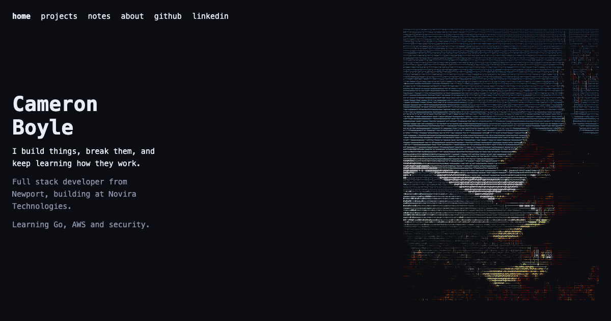

# cbb00-portfolio

My personal site: a small animated pagoda drawn entirely in text characters, with my projects, notes and a bit about me.



It is a hand-built static site on [Bun](https://bun.sh) and React, with no UI library and no framework. The things I cared about were speed, accessibility and being readable as code.

|                | Lighthouse (built site, phone and desktop) |
| -------------- | ------------------------------------------ |
| Performance    | 100                                        |
| Accessibility  | 100                                        |
| Best practices | 100                                        |
| SEO            | 100                                        |

These are checked by `bun run audit` and by CI, so a change that lowers them fails the build.

## What's in it

- **The pagoda.** A photo turned into a grid of characters ahead of time (`scripts/prep-pagoda.ts`). The browser draws it on a canvas, with petals on the wind that you can push with the cursor or a tap. Phones get a coarser picture with bigger characters.
- **Pages.** Home, Projects (case studies: problem, choices, result), Notes and About. Content lives in plain data files, so adding a project or a post means adding an object.
- **Pre-rendered HTML.** The build writes every page as real HTML, so search engines and link previews see the content without running JavaScript. React then attaches to it.
- **Accessible by default.** Skip link, one `h1` per page, focus moves to the content after a page change, links that open a new tab say so, `rem` text sizes, large tap targets, and the pagoda stops moving for people who ask for reduced motion.
- **Small and fast.** About 3 KB of CSS and JetBrains Mono at 43 KB are the only assets besides the script. The phone and desktop pictures are separate files, so a phone downloads only its own.

## Run it

```sh
bun install
bun run dev          # http://localhost:3000, live reload (PORT=3100 bun run dev for another port)
bun run test         # unit tests in test/
bun run typecheck
bun run build        # writes the finished site to dist/
bun run preview      # serves dist/ like a static host, at http://localhost:4000
bun run audit        # builds, then runs Lighthouse and real-browser checks (needs Chrome)
bun run check        # typecheck, tests and build together
```

`bun run audit` fails if any Lighthouse score drops below its limit (performance 95, the rest 100), if the keyboard order or focus handling breaks, if any page scrolls sideways from 320px to 1440px wide, if a link is too small to tap, or if there are console errors.

## Deploying

The site is static, so it runs on any static host. I use [Vercel](https://vercel.com) (free Hobby plan), connected to this repository, at <https://cambboyle.me>. `vercel.json` holds the settings, so there is nothing to type into the dashboard except one variable:

| Where              | Setting                                                         |
| ------------------ | --------------------------------------------------------------- |
| `vercel.json`      | `bun install --frozen-lockfile`, `bun run build`, output `dist` |
| `vercel.json`      | `cleanUrls` on and `trailingSlash` off, so `about.html` is served at `/about` |
| `vercel.json`      | security headers, and long caching for the hashed files        |
| Vercel dashboard   | environment variable `SITE_URL` = `https://cambboyle.me`        |

`SITE_URL` makes the build write canonical links, absolute share-image URLs, `sitemap.xml` and an RSS feed of Notes (`/feed.xml`); without it they are left out.

The headers include a content security policy that allows no outside scripts. `bun run preview` and `bun run audit` read the same `vercel.json`, so a rule that would break the site shows up before it is live. The build writes each page as a flat file (`dist/projects/camdex.html`), and Vercel serves a missing address with `404.html`.

## Where things live

- `src/pages/` has one file per page; `src/App.tsx` picks the page from the URL and draws the nav.
- `src/router.tsx` is a small history-API router (no library).
- `src/meta.ts` has each page's title and description and the list of pages to build.
- `src/data/projects.ts` and `src/data/posts.ts` hold the content. A project with a `study` gets its own page at `/projects/<slug>`.
- `src/PagodaArt.tsx` draws the pagoda. It draws the picture once per size, then each frame copies it and redraws only the cells that twinkle.
- `scripts/build.tsx` bundles the app and writes the pages; `scripts/preview.ts` serves `dist/`; `scripts/audit.ts` checks the result.
- `test/` has the tests: unique slugs, complete case studies, pagoda data shape, page titles and descriptions, the RSS feed and the font files.

## How the pagoda is made

```sh
bun run art    # makes src/art/pagoda.json (150 columns) and src/art/pagoda-small.json (80 columns, for phones)
```

`scripts/prep-pagoda.ts` reads the photo, mirrors and crops it, and shrinks it to a grid of cells. Each cell gets a character from its brightness (or from the edge direction where there is a strong line) and a colour from the photo. Local contrast is added so Mount Fuji's slope and the pagoda's roofs stand out, the open sky is dimmed so it frames the subject, and shadows are lifted. The photo itself is not in the repository; the script expects it at `~/Downloads/refs/pagoda-original/original.jpg`.

## Font

[JetBrains Mono](https://www.jetbrains.com/lp/mono/) (SIL Open Font License; the licence text is in `public/fonts/`), in two weights, Latin only. `font-display: swap` shows text straight away in a local monospace font sized to match JetBrains Mono, so little moves when the font arrives, and the pagoda redraws once it has loaded.

## Credits

- **Photo:** [Temple near trees during day](https://unsplash.com/photos/temple-near-trees-during-day-PMkQ7WVWqr0) by Svetlana Gumerova ([@bananablackcat](https://unsplash.com/@bananablackcat)) on [Unsplash](https://unsplash.com), used under the [Unsplash License](https://unsplash.com/license). The site shows an ASCII version of it, not the photo itself.
- **Font:** JetBrains Mono, by the JetBrains Mono Project Authors, under the SIL Open Font License 1.1.
